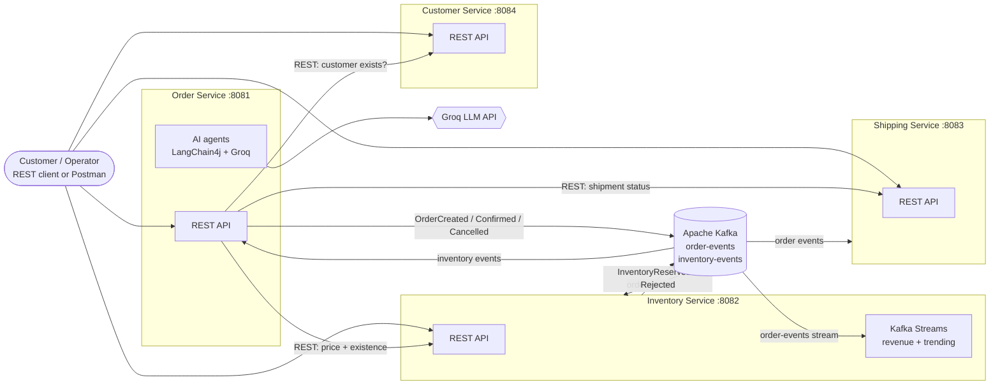
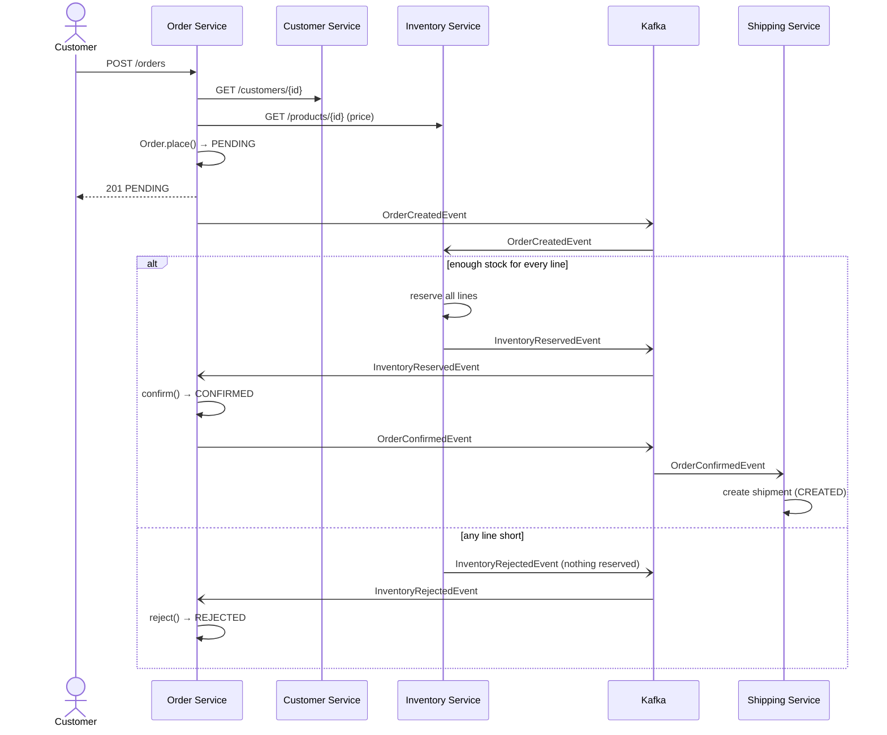
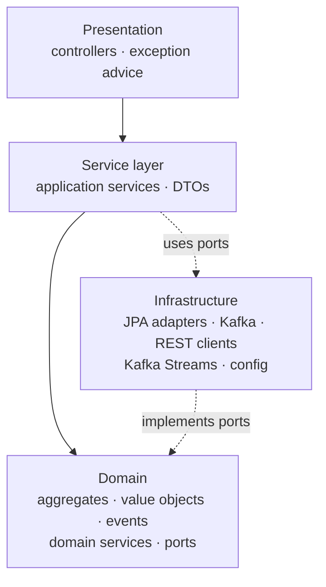

# 1. Architecture

> **Status:** describes the code as implemented (verified against the running system on 2026-10-08).
> These specification files are repository artefacts. The course **project report must be written by the team**
> in their own words; use these files as source material and reference them where appropriate.

## 1.1 System overview

ScentHub is an online perfume retailer. Four independently deployable Spring Boot microservices, one per bounded
context, own their data and cooperate through Apache Kafka events (asynchronous) and a few REST calls (synchronous
look-ups that need an immediate answer).

## 1.2 Services

| Service | Port | Bounded context | Owns | Talks to |
|---|---|---|---|---|
| `order-service` | 8081 | Ordering | orders, order items | REST: Inventory, Customer, Shipping · Kafka: publishes `order-events`, consumes `inventory-events` · LLM API |
| `inventory-service` | 8082 | Product catalogue & stock | products, stock counters, stream state stores | Kafka: consumes `order-events`, publishes `inventory-events` |
| `shipping-service` | 8083 | Fulfilment | shipments | Kafka: consumes `order-events` |
| `customer-service` | 8084 | Customer relationship | customers, feedback, complaints | none (deliberately decoupled) |

Why these boundaries: each owns a distinct vocabulary and rules (an *order line* is not a *stock reservation* is not a
*shipment*), changes for different reasons, and can fail or scale independently. Shipping and Customer need no
knowledge of each other; Order is the only service that coordinates, and it does so through narrow interfaces (ports).

## 1.3 Communication styles

| Style | Used for | Why |
|---|---|---|
| **Kafka events** (`order-events`, `inventory-events`) | Reserving stock, confirming/rejecting orders, creating/cancelling shipments, analytics | The sender does not wait; services stay decoupled and can be down temporarily |
| **REST (synchronous)** | Order → Inventory (price, existence), Order → Customer (existence), Order → Shipping (is it dispatched?) | The answer is needed *now* to accept or refuse the request |
| **Kafka Streams** | Revenue and trending products | Continuous aggregation of the event stream, queried in real time |

### Order lifecycle across services (sequence)

## 1.4 Layered architecture (identical in every service)

| Layer | Packages (`com.ecommerce.<service>`) | Responsibility |
|---|---|---|
| Presentation | `presentation.controller` | HTTP only: parse request, call one service method, map exceptions to status codes (`ApiExceptionHandler`) |
| Service | `service`, `service.dto`, `service.agent` (order) | Use-case orchestration: load aggregate → call domain behaviour → save → publish events. No business rules |
| Domain | `domain.model`, `.event`, `.service`, `.repository`, `.port`, `.exception` | The business rules and the interfaces (ports) the domain needs from the outside world |
| Infrastructure | `infrastructure.persistence`, `.messaging`, `.client`, `.streams`, `.config` | All technology: Spring Data adapters, Spring Cloud Stream, `RestTemplate` clients, Kafka Streams, wiring |

The package tree of each service is the layering: nothing in `domain` imports Spring web, Kafka or HTTP classes (the
only framework dependency is JPA annotations on the aggregates, a deliberate pragmatic choice).

## 1.5 Technology

| Concern | Choice |
|---|---|
| Language / build | Java 21, Maven multi-module (`pom.xml` at the root) |
| Framework | Spring Boot 3.2.5, Spring Web, Spring Data JPA, H2 (in-memory, local development) |
| Messaging | **Spring Cloud Stream** 4.1.x (Spring Cloud 2023.0.1), Kafka binder; functional style (`Consumer<String>` beans, `StreamBridge`) |
| Stream processing | Kafka Streams through the Spring Cloud Stream Kafka Streams binder, queried with `InteractiveQueryService` |
| Agentic AI | LangChain4j 1.3.0 (`AiServices` + `@Tool`), model served by Groq (`llama-3.1-8b-instant`) through its OpenAI-compatible API |
| Broker | Apache Kafka + Zookeeper (Confluent images) via `docker-compose.yml` |
| Testing | JUnit 5, AssertJ, Spring Boot Test, Spring Cloud Stream test binder, `scripts/smoke-test.sh` |

## 1.6 Cross-cutting design decisions

| Decision | Reason |
|---|---|
| Events are published **after** the database transaction commits | Never announce something that was rolled back |
| One JSON **envelope** `{eventType, eventId, timestamp, payload}` for every message | One parser, easy to extend, easy to debug with a console consumer |
| Aggregates carry `@Version` (optimistic locking) | Two simultaneous changes to the same order/product cannot silently overwrite each other; the loser is retried |
| Stock is reserved **all-or-nothing** per order | A partial reservation would leave inconsistent state |
| Rejection publishes no event | A rejected order is a dead end; the customer sees it on the next `GET /orders/{id}` |
| Short HTTP timeouts and a `503` mapping | A slow dependency must not hang order creation |
| Spring Cloud Stream bindings configured in YAML, not code | Topics/groups change without touching Java |
| Inventory runs **two** binders (`kafka`, `kstream`), each with `inheritEnvironment: false` | The two binders collide if they share one environment; consequence: binding-level Kafka settings must live inside the binder's `environment:` block, and each Kafka Streams function needs its own `applicationId` and `state.dir` |

## 1.7 Known limitations
See the root `README.md` ("Known limitations"): no authentication, in-memory databases, no transactional outbox,
revenue counts rejected orders, stock reserved at order time (no payment step).
