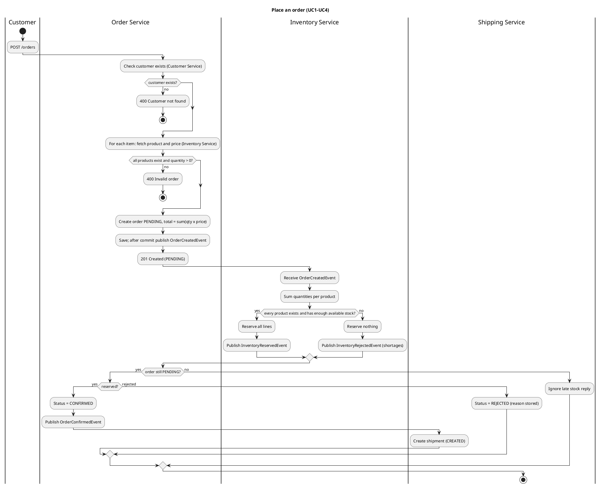
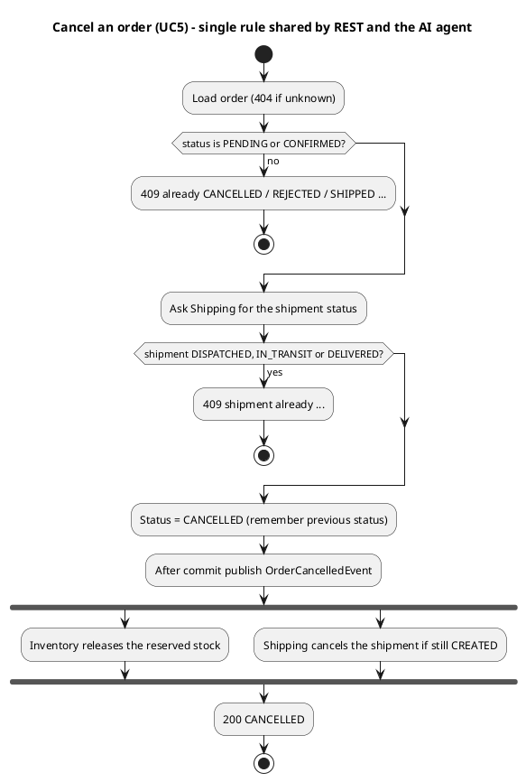
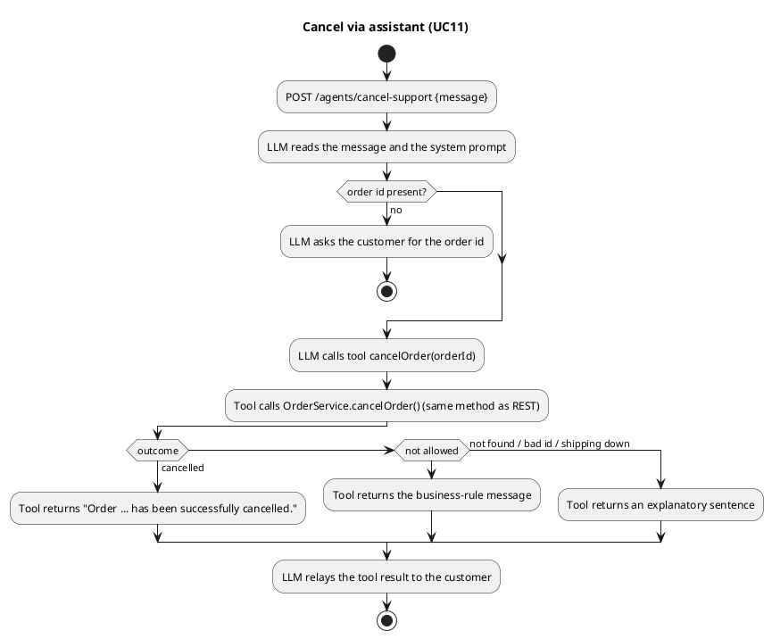
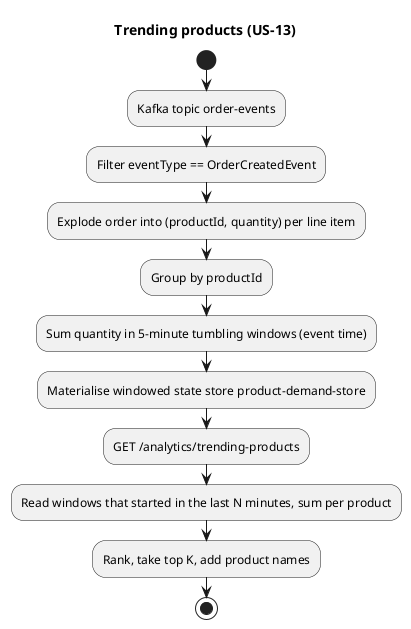

# 2. Analysis and requirements

> Source material for report Section 1 and Section 2. Every requirement below is **implemented and verified**
> (tests: `mvn test`; end to end: `scripts/smoke-test.sh`; sample I/O: `8-sample-inputs-outputs.md`).
> Diagrams use PlantUML (UML activity diagrams) - paste a block into https://www.plantuml.com/plantuml to render it.

## 2.1 Business case

**Problem.** A small online perfume retailer sells scarce stock. Without coordination it oversells items, leaves
customers waiting on manual support for cancellations and product questions, and has no live view of what is selling.

**Objectives**

| ID | Objective | Stakeholder |
|---|---|---|
| O1 | Never sell stock that does not exist (no overselling) | Store manager |
| O2 | Process orders quickly and automatically from order to shipment | Customer, warehouse operator |
| O3 | Let customers help themselves (ask about products, cancel orders) around the clock | Customer, support staff |
| O4 | Give the business live insight into revenue, demand and low stock | Store manager |
| O5 | Capture feedback and complaints in one place | Support staff, store manager |

**Core capabilities:** catalogue and stock management; validated order placement with real prices; automatic stock
reservation and order confirmation; shipment tracking; cancellation with stock release; customer feedback and
complaints; real-time analytics over the order stream; two LLM agents (product consultation, cancellation support).

**How AI adds value.** The product-consultation agent answers questions from *live* catalogue data (tool calls to
Inventory), so answers carry real prices and stock rather than guesses. The cancellation agent turns a free-text request
("please cancel order …") into the *same* business operation the REST API uses, so support staff are not needed for the
routine case, and the business rules (not the model) decide whether cancelling is allowed.

## 2.2 Functional requirements

| ID | Requirement | Service | Relevance (objective) | Type |
|---|---|---|---|---|
| FR1 | Register a customer and update the profile (name, unique email) | customer | O5 (know who is talking to us) | CRUD |
| FR2 | Manage the product catalogue: create, update (partial), delete, browse, case-insensitive search | inventory | O1, O3 (accurate stock and prices) | CRUD |
| FR3 | Place an order for a known customer and known products; price each line from the catalogue; reject bad input | order | O2 (fast, correct orders) | Command |
| FR4 | Reserve stock for an order automatically and all-or-nothing | inventory | O1 | Event-driven |
| FR5 | Confirm the order when stock is reserved, reject it (with a reason) when it is not | order | O1, O2 | Event-driven |
| FR6 | Create a shipment automatically for every confirmed order | shipping | O2 | Event-driven |
| FR7 | View and update a shipment's status (created → dispatched → in transit → delivered) | shipping | O2 | CRUD |
| FR8 | Cancel an order, only while it is still cancellable; release the reserved stock and cancel the shipment | order, inventory, shipping | O1, O3 | Command + events |
| FR9 | View one order and a customer's order history | order | O3 | Query |
| FR10 | Submit feedback with an optional 1-5 rating | customer | O5 | Command |
| FR11 | Raise a complaint and list a customer's complaints | customer | O5 | Command + query |
| FR12 | Report products whose available stock is below a threshold | inventory | O4, O1 | Query |
| **FR13** | **Report total revenue in real time** from the stream of orders | inventory (Kafka Streams) | O4 | **Real-time analysis** |
| **FR14** | **Report the trending products** (units ordered in the last N minutes) from the stream of orders | inventory (Kafka Streams) | O4 | **Real-time analysis** |
| **FR15** | **Answer product questions** in natural language using live catalogue data | order (LangChain4j agent) | O3 | **Agentic AI** |
| **FR16** | **Cancel an order from a natural-language request** using the same cancellation rule as FR8 | order (LangChain4j agent) | O3 | **Agentic AI** |
| FR17 | Fail fast and clearly when a dependency is down (503) and refuse invalid requests (400/404/409) | all | O2 | Quality |

Non-functional notes: services are independently deployable and own their data; events are published after commit;
optimistic locking prevents lost updates; the system runs locally with one `docker compose up` plus four `mvn
spring-boot:run`.

## 2.3 User stories and acceptance criteria

(US-nn matches the sample input/output in `8-sample-inputs-outputs.md`.)

| ID | Story | Acceptance criteria | FR |
|---|---|---|---|
| US-01 | As a **customer** I want to register so that I can order | `201` with a customerId; duplicate email (any letter case) → `409`; malformed email or blank name → `400` | FR1 |
| US-02 | As a **store manager** I want to add and edit products so that the catalogue is current | `201` with `availableQuantity = stock`; negative price/stock or blank name → `400`; stock cannot be set below what is reserved → `400` | FR2 |
| US-03 | As a **customer** I want to browse and search products so that I can choose | `GET /products` lists all; `?search=` matches names case-insensitively | FR2 |
| US-04 | As a **customer** I want to place an order so that I receive my perfume | `201 PENDING`; total = Σ quantity × catalogue price; unknown customer/product, empty order or quantity ≤ 0 → `400`; dependency down → `503`. Later `CONFIRMED` (stock reserved) or `REJECTED` (not enough stock, nothing reserved) | FR3-FR5 |
| US-05 | As a **customer** I want to see my order and its history so that I know where it is | `GET /orders/{id}` (`404` if unknown); `GET /orders?customerId=` (empty list allowed) | FR9 |
| US-06 | As a **customer** I want a shipment created once my order is confirmed so that it gets sent | a shipment with status `CREATED` exists shortly after `CONFIRMED`; a duplicate event creates no second shipment | FR6 |
| US-07 | As a **warehouse operator** I want to update the shipment status so that customers see progress | `PATCH /shipments/{orderId}/status`; unknown status → `400`; no shipment → `404` | FR7 |
| US-08 | As a **customer** I want to cancel an order that has not shipped so that I am not charged for what I no longer want | `200 CANCELLED`, reserved stock released, shipment `CANCELLED`; cancelling again, a `REJECTED` order, or one whose shipment is `DISPATCHED`/`IN_TRANSIT`/`DELIVERED` → `409` | FR8 |
| US-09 | As a **customer** I want to leave feedback so that the shop improves | `201`; rating outside 1-5 or blank text → `400`; unknown customer → `404` | FR10 |
| US-10 | As a **customer** I want to raise and list complaints so that problems are tracked | `201` with status `OPEN`; list per customer | FR11 |
| US-11 | As a **store manager** I want a low-stock report so that I can reorder | products with available < threshold (default 10) | FR12 |
| **US-12** | As a **store manager** I want **live total revenue** so that I see how the shop is doing right now | `GET /analytics/revenue` returns the running sum over all `OrderCreatedEvent`s, updated within seconds, `0.0` when empty, unchanged after a service restart | FR13 |
| **US-13** | As a **store manager** I want to see **which products are trending** so that I can restock the popular ones | `GET /analytics/trending-products?minutes=&limit=` ranks products by units ordered in the last N minutes (5-minute windows) | FR14 |
| **US-14** | As a **customer** I want to **ask an assistant about products** so that I can choose without browsing | agent answers from live catalogue data; says so when nothing matches; falls back to a polite message if the LLM is unavailable | FR15 |
| **US-15** | As a **customer** I want to **tell an assistant to cancel my order** so that I do not need a form | agent calls the same cancellation operation as US-08 and relays the exact outcome (success / why not / not found); never claims success unless the tool confirms it | FR16 |

**Real-time analysis stories (requirement: at least 2):** US-12 and US-13.
**Agentic AI stories (requirement: at least 2):** US-14 and US-15.

## 2.4 Use cases

| UC | Name | Actor | Main flow (summary) | Alternative / exception flows |
|---|---|---|---|---|
| UC1 | Place order | Customer | Validate customer and products → price lines → create PENDING order → publish `OrderCreated` | unknown customer/product, bad quantity → 400 · dependency down → 503 |
| UC2 | Reserve stock | Inventory (system) | On `OrderCreated`, check every line → reserve all → publish `InventoryReserved` | any line short → reserve nothing → publish `InventoryRejected` · unknown product → rejected `PRODUCT_NOT_FOUND` |
| UC3 | Confirm / reject order | Order (system) | On `InventoryReserved` → CONFIRMED → publish `OrderConfirmed` · on `InventoryRejected` → REJECTED | order no longer PENDING → reply ignored |
| UC4 | Create shipment | Shipping (system) | On `OrderConfirmed` → shipment CREATED | duplicate event → ignored |
| UC5 | Cancel order | Customer | Check order status, then shipment status → CANCELLED → publish `OrderCancelled` → inventory releases stock, shipping cancels shipment | not cancellable → 409 · unknown → 404 · shipping down → 503 |
| UC6 | Update shipment status | Warehouse operator | PATCH new status | unknown status → 400 · no shipment → 404 |
| UC7 | Manage catalogue | Store manager | create / update / delete / search products | invalid data → 400 · unknown → 404 |
| UC8 | Customer profile, feedback, complaints | Customer | register, update, submit feedback/complaint, list complaints | validation → 400 · duplicate email → 409 · unknown → 404 |
| UC9 | View live analytics | Store manager | read revenue, trending products, low stock | stream still starting → empty/0.0 |
| UC10 | Ask product assistant | Customer | message → agent → `searchProducts` tool → reply | LLM unavailable → fallback message |
| UC11 | Cancel via assistant | Customer | message → agent → `cancelOrder` tool → reply | not allowed / not found / bad id → tool returns an explanatory sentence |

## 2.5 UML activity diagrams (PlantUML)

### UC1 + UC2 + UC3 + UC4 - Place an order, end to end

### UC5 - Cancel an order

### UC10/UC11 - Agentic flow (tool-using LLM agent)

### FR14 - Trending products (stream processing)

## 2.6 Real-time analysis requirements (detail)

| Story | Streaming query (KSQL-style) | Implementation |
|---|---|---|
| US-12 revenue | `SELECT SUM(totalAmount) FROM order_events WHERE eventType='OrderCreatedEvent'` | `RevenueStreamsTopology` → persistent key-value store `revenue-store`, key `TOTAL` |
| US-13 trending | `SELECT productId, SUM(quantity) FROM order_created_items WINDOW TUMBLING (SIZE 5 MINUTES) GROUP BY productId` | `ProductDemandTopology` → windowed store `product-demand-store` |

Both are read through `InteractiveQueryService` (`StreamsOrderStatistics`) and need no manual refresh. Restart
behaviour (state store + committed offsets, so no double counting) was verified for revenue; the trending store uses
the same mechanism but a restart test for it has not been run.
