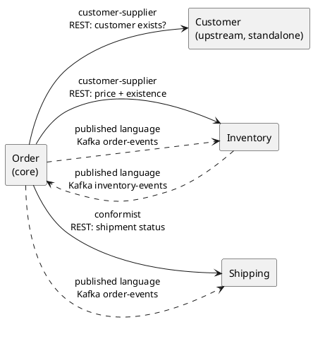

# 3. Domain model

> Source material for report Section 2.4 (domain modelling) and Section 3.3 (DDD patterns). PlantUML diagrams:
> paste into https://www.plantuml.com/plantuml to render.

## 3.1 Sub-domains and bounded contexts

| Sub-domain | Type | Bounded context (service) | Core concepts (ubiquitous language) |
|---|---|---|---|
| Ordering | **Core** - what the business is | Order | Order, OrderItem, OrderStatus, Money, cancellation |
| Stock & catalogue | Supporting | Inventory | Product, stock, reserved, available, reservation, shortage |
| Fulfilment | Supporting | Shipping | Shipment, ShipmentStatus |
| Customer relationship | Supporting / generic | Customer | Customer, Email, Feedback, Complaint |
| Analytics | Supporting | Inventory (read side) | revenue, demand per product, windows |

The same word means different things per context on purpose: a *product* in Order is just an id and a unit price on
an order line; in Inventory it is an aggregate with stock counters. Each context therefore has its own model and
`Money` value object, and contexts exchange *ids and events*, never each other's objects.

### Context map

Integration uses an anti-corruption approach: each service has its own small DTO/payload classes for what it reads
from others (e.g. `InventoryProductResponse` in Order, `OrderCreatedPayload` in Inventory) and maps them to its own
types at the edge (`ProductSnapshot`, `StockLine`).

## 3.2 Class diagram

```plantuml
@startuml
skinparam classAttributeIconSize 0
package "Order context" {
  class Order <<Aggregate Root>> {
    id: UUID
    customerId: UUID
    status: OrderStatus
    totalAmount: Money
    rejectionReason: String
    version: Long
    +{static} place(customerId, lines): Order
    +confirm(): boolean
    +reject(reason): boolean
    +cancel()
    +isCancellable(): boolean
    +pullEvents(): List<DomainEvent>
  }
  class OrderItem <<Entity>> { productId; quantity; unitPrice: Money; lineTotal(): Money }
  class Money <<Value Object>> { amount: BigDecimal; plus(); times() }
  enum OrderStatus { PENDING; CONFIRMED; REJECTED; CANCELLED; SHIPPED; COMPLETED }
  class CancellationPolicy <<Domain Service>> { +verifyCancellable(order, shipmentStatus) }
  interface DomainEvent <<Domain Event>>
  class OrderPlaced
  class OrderConfirmed
  class OrderCancelled
  class OrderRejected
  Order "1" *-- "1..*" OrderItem
  Order --> OrderStatus
  Order ..> Money
  OrderItem ..> Money
  Order ..> DomainEvent : raises
  DomainEvent <|.. OrderPlaced
  DomainEvent <|.. OrderConfirmed
  DomainEvent <|.. OrderCancelled
  DomainEvent <|.. OrderRejected
}
package "Inventory context" {
  class Product <<Aggregate Root>> {
    id: UUID
    name; description
    price: Money
    stockQuantity: int
    reservedQuantity: int
    version: Long
    +availableQuantity(): int
    +canReserve(q): boolean
    +reserve(q)
    +release(q): boolean
    +update(...)
  }
  class StockReservationService <<Domain Service>> { +reserveAll(orderId, lines, products): InventoryEvent }
  interface InventoryEvent <<Domain Event>>
  class StockReserved
  class StockRejected
  class StockLine <<Value Object>>
  class Shortage <<Value Object>>
  Product ..> "Money"
  StockReservationService ..> Product
  InventoryEvent <|.. StockReserved
  InventoryEvent <|.. StockRejected
  StockRejected o-- Shortage
  StockReserved o-- StockLine
}
package "Shipping context" {
  class Shipment <<Aggregate Root>> { id; orderId (unique); status: ShipmentStatus; +createFor(); +changeStatus(); +cancelIfNotDispatched() }
  enum ShipmentStatus { CREATED; DISPATCHED; IN_TRANSIT; DELIVERED; CANCELLED }
  Shipment --> ShipmentStatus
}
package "Customer context" {
  class Customer <<Aggregate Root>> { id; name; email: Email; +register(); +updateProfile() }
  class Email <<Value Object>> { address (validated, lower-case) }
  class Feedback <<Aggregate>> { customerId; content; rating 1-5 }
  class Complaint <<Aggregate>> { customerId; content; status: ComplaintStatus }
  Customer --> Email
  Feedback ..> Customer : by id
  Complaint ..> Customer : by id
}
@enduml
```

## 3.3 DDD patterns and why each class is what it is

| Pattern | Where | Why this class qualifies |
|---|---|---|
| **Aggregate root** | `Order`, `Product`, `Shipment`, `Customer` | Each is the single entry point to a cluster that must stay consistent *together* (an order and its lines; a product and its counters). Outside code never changes `OrderItem` or the counters directly, and each is saved/loaded as a unit. |
| **Entity** | `OrderItem` | Has identity (id) and lives and dies with its `Order`; reachable only through the root. |
| **Separate small aggregates** | `Feedback`, `Complaint` | They are immutable-ish records that reference a customer by *id*. Putting them inside `Customer` would make every profile edit load an unbounded history. |
| **Value object** | `Money`, `Email`, `OrderLineDraft`, `StockLine`, `Shortage`, `ShipmentStatus`, `ComplaintStatus` | No identity, immutable, equal when their values are equal, validate themselves on creation (`Money` is never negative; `Email` is normalised so `Jane@X.com` equals `jane@x.com`). |
| **Domain event** | `OrderPlaced`, `OrderConfirmed`, `OrderCancelled`, `OrderRejected`, `StockReserved`, `StockRejected` | Record a business fact that already happened, named in the past tense, raised by the aggregate (`Order.pullEvents()`), published after commit, translated by infrastructure into Kafka messages. |
| **Domain service** | `CancellationPolicy`, `StockReservationService` | The rule spans more than one aggregate or an outside fact, so it fits no single aggregate: cancelling needs the order *and* the shipment status; reserving needs *several* products at once, all-or-nothing. They are stateless. |
| **Repository (port + adapter)** | `OrderRepository` ↔ `OrderRepositoryAdapter`, same for Product, Shipment, Customer… | The domain asks for an aggregate by id without knowing about Spring Data/SQL. |
| **Application service** | `OrderService`, `StockService`, `ShipmentService`, `CustomerService`… | Orchestrates a use case; contains no business rule. |
| **Optimistic locking** | `@Version` on every aggregate root | Protects aggregate invariants under concurrency. |

### Invariants enforced inside the aggregates
- `Order`: at least one line; every quantity > 0; only `PENDING` can be confirmed/rejected; only `PENDING`/`CONFIRMED` can be cancelled; the total is the sum of its lines.
- `Product`: name required; price and stock ≥ 0; `reserved ≤ stock`; reserving needs enough *available* stock; releasing never goes below 0.
- `Shipment`: one per order; auto-cancel only while `CREATED`.
- `Customer`: name required; valid unique email. `Feedback`: rating 1-5 if present. `Complaint`: starts `OPEN`.

Code sample (the order aggregate):
```java
public boolean confirm() {
    if (status != OrderStatus.PENDING) return false;       // a late stock reply must not resurrect a cancelled order
    status = OrderStatus.CONFIRMED;
    touch();
    domainEvents.add(new OrderConfirmed(id, customerId, eventLines(), updatedAt));
    return true;
}
```

## 3.4 Justification against the business domain
The model follows the shop's real workflow (order → stock → shipment), puts the rules the business cares about
(no overselling, no cancelling parcels that have left) inside the aggregates that own the data, and draws service
boundaries where vocabulary, rate of change and failure modes differ. Reservation across several products and the
cancellation decision are the two rules that cross aggregates, so they are domain services; everything else stays on
the aggregate it belongs to.
