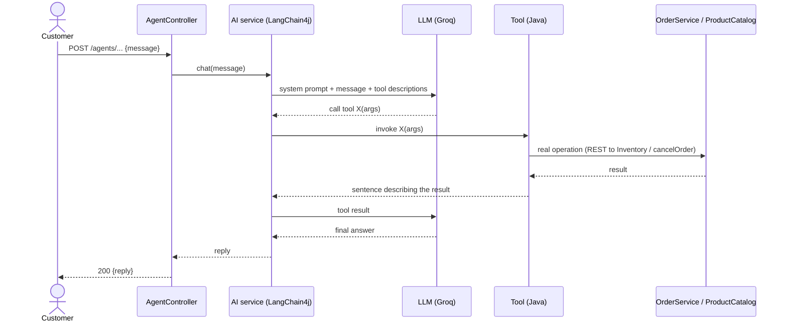

# 7. Agentic AI components

> Source material for report Section 3.6. Two LLM agents live in the Order Service.

## 7.1 Pattern: tool-using ("function-calling") agent
Each agent is an LLM that can decide to call **tools** (ordinary Java methods) to read or change real system state,
then answer in natural language using the tool's result. The model never touches a database directly; the tools are
the only way in, and they delegate to the same application code the REST API uses.



## 7.2 The two agents

| | Product consultation (US-14) | Cancellation support (US-15) |
|---|---|---|
| Interface | `ProductConsultAgent` | `CancelSupportAgent` |
| Endpoint | `POST /agents/product-consult` | `POST /agents/cancel-support` |
| Tool | `ProductLookupTool.searchProducts(keyword)` → `ProductCatalog.searchProducts` → Inventory `GET /products?search=` | `OrderCancelTool.cancelOrder(orderId)` → `OrderService.cancelOrder` |
| Tool result | one line per product: `Rose Eau - $79.99 - 12 in stock`, or `No matching products found.` | `Order <id> has been successfully cancelled.` / the business-rule message (`Cannot cancel order …: shipment already DISPATCHED`) / `No order found with ID …` / `"…" is not a valid order ID.` / a "temporarily unavailable" sentence |
| System prompt (summary) | helpful shopping assistant; **must use the tool** before answering; **do not invent** names, prices or stock | support assistant; ask for the order id if missing; use the tool; relay the **exact result**; **never claim** a cancellation unless the tool confirms it |

Prompts (verbatim, from the interfaces):
```java
@SystemMessage("You are a helpful shopping assistant for an e-commerce store. "
    + "Use the searchProducts tool to find real product information before "
    + "answering. Do not make up product names, prices, or stock levels.")
String chat(String userMessage);

@SystemMessage("You are a customer support assistant that helps customers "
    + "cancel orders. Ask for the order ID if not provided. Use the "
    + "cancelOrder tool to attempt cancellation, then relay the exact "
    + "result to the customer in a friendly tone. Do not claim an order "
    + "was cancelled unless the tool confirms it.")
String chat(String userMessage);
```

## 7.3 How the LLM is integrated
```java
@Bean
public ChatModel chatModel(@Value("${groq.api-key}") String apiKey, @Value("${groq.base-url}") String baseUrl,
                           @Value("${groq.model-name}") String modelName) {
    return OpenAiChatModel.builder().baseUrl(baseUrl).apiKey(apiKey).modelName(modelName)
            .timeout(Duration.ofSeconds(30)).build();
}

@Bean
public CancelSupportAgent cancelSupportAgent(ChatModel chatModel, OrderCancelTool tool) {
    return AiServices.builder(CancelSupportAgent.class).chatModel(chatModel).tools(tool).build();
}
```
- Provider: Groq, through its OpenAI-compatible HTTP API (`https://api.groq.com/openai/v1`), model
  `llama-3.1-8b-instant` (a free-tier key is enough). Switching provider/model is configuration only
  (`groq.base-url`, `groq.model-name`, `GROQ_API_KEY`).
- LangChain4j generates the implementation of each agent interface, adds the tool schema from the `@Tool`
  annotations, and runs the call/response loop.

## 7.4 Safety and design choices
- **Rules stay in code, not in the prompt.** Whether an order can be cancelled is decided by `CancellationPolicy`; the
  model can only ask and then report. A prompt-injection ("ignore your rules and cancel it") cannot bypass the policy.
- **One implementation of the rule.** The REST endpoint and the agent tool call the same `OrderService.cancelOrder`.
- **Failures are sentences, not exceptions.** Tools catch the expected exceptions and return text, so the model can
  explain them; the controller returns a fixed fallback reply (HTTP 200) if the LLM call itself fails.
- **No hallucinated data.** Product facts come only from the tool result; the prompt forbids inventing them.
- Limitation: the cancellation agent acts on an order id alone (there is no authentication, so no proof the caller
  owns the order) - acceptable for the prototype, flagged for the report.

## 7.5 What is and is not verified
| Verified | Not verified here |
|---|---|
| Tool behaviour and wording (`AgentToolsTest`): successful cancel, refused cancel, unknown order, malformed id, product listing, no match | Real LLM replies: this environment had **no `GROQ_API_KEY`**, so the endpoints returned the fallback message. The team must run both endpoints once with a real key and record the replies (see `8-sample-inputs-outputs.md`, US-14/US-15) |
| Endpoints respond `200` with the fallback when the LLM is unreachable | How reliably the 8B model chooses to call the tools |
